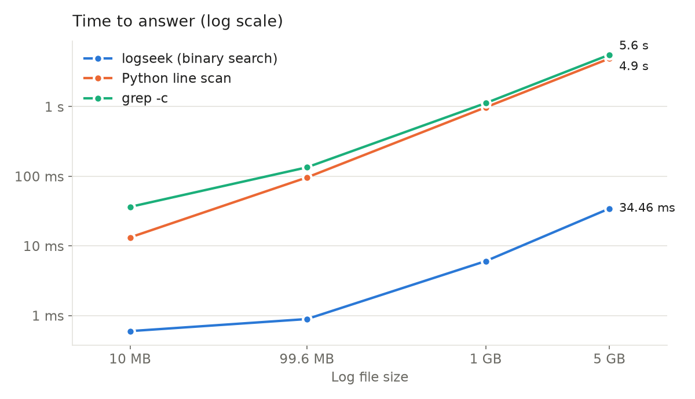

# logseek

[](https://github.com/Samandar688/logseek/actions/workflows/tests.yml)

**Live demo:** https://logseek.onrender.com (100 MB demo log; free plan, so the first visit after a quiet spell takes ~1 min to wake up)

Find any time range in a **multi-gigabyte log file in milliseconds**, without reading the
whole file and without loading it into memory.

Log lines are written in time order, so the file is already sorted. logseek jumps to the
middle **byte** of the file (`seek()`), reads the timestamp of the next full line, and keeps
halving the range: a 5 GB file needs about 33 jumps instead of reading 5 GB.

## Roadmap

- [x] 1. Log generator (realistic day of logs, any size)
- [x] 2. Core: binary search on bytes (1 GB file: 30 jumps, 0.34 ms, 6.5 KB read vs 1.7 s / 468 MB linear)
- [x] 3. Query engine + CLI (stream the window, filter by level/service/text, hourly histogram)
- [x] 4. API + web page (jump animation, volume + error histograms with zoom, search table)
- [x] 5. Benchmarks vs `grep` / linear scan (5 GB: 34 ms vs 5.6 s, [results](bench/RESULTS.md))
- [x] 6. Docker, CI, deploy, README

## Use it

```bash
logseek data/app.log --from 14:05 --to 14:10 --level ERROR --service orders
logseek data/app.log --from 14:05 --to 14:10 --level ERROR --count
logseek data/app.log --from 09:00 --to 10:00 --grep timeout --limit 20
logseek data/app.log --histogram
```

Matching lines go to stdout, a summary goes to stderr. On a 1 GB file:

```
5,162 matches / 85,034 entries in window (5.7 MB of 1,020.7 MB) | binary search 60 jumps 0.28 ms | scan 111 ms
```

### Benchmarks

*How many ERROR lines between 14:05 and 14:10?* Same answer from all three methods:

| File | logseek | Python scan | grep |
|---|---|---|---|
| 100 MB | 0.89 ms | 96 ms | 134 ms |
| 1 GB | 6.1 ms | 979 ms | 1.1 s |
| 5 GB | 34 ms | 4.9 s | 5.6 s |



Details and how to run them: [bench/RESULTS.md](bench/RESULTS.md).

### Web page

```bash
logseek-web data/app.log --port 8000      # then open http://127.0.0.1:8000
```

- **The file, as bytes:** the search jumps across the file, step by step.
- **Whole day:** log volume per 15 minutes (binary search only) and errors per 15 minutes
  (a fast byte count). Incidents stand out; click a bar to zoom in and search it.
- **Search:** time, level, service, text; results with the time each part took.

## Run with Docker

```bash
docker build -t logseek .                  # bakes a 100 MB demo log into the image
docker run -p 8000:8000 logseek            # open http://127.0.0.1:8000
docker run -p 8000:8000 -v /path/to/your.log:/app/data/app.log logseek   # your own log
```

Smaller demo log: `docker build --build-arg LOG_SIZE=10MB -t logseek .`

Deploy: `render.yaml` is a Render blueprint (free plan). The image already contains the
demo log, so the free 0.1 CPU instance starts in seconds.

## How it works

| File | What it does |
|---|---|
| `logseek/generator.py` | Writes a realistic day of logs of any size, with 3 incidents (09:12, 14:05, 21:40) |
| `logseek/search.py` | Binary search on byte offsets: `seek()`, skip to the next line, compare timestamps |
| `logseek/query.py` | Streams only the found window in 1 MB chunks; filters; histograms from binary search |
| `logseek/cli.py` | The `logseek` command |
| `logseek/web.py`, `static/` | FastAPI + D3 page: jump animation, histograms with zoom, search |
| `logseek/bench.py` | Benchmarks against a Python scan and `grep` |

## Run (dev)

```bash
python -m venv .venv
.venv\Scripts\activate            # Linux/macOS: source .venv/bin/activate
pip install -e ".[dev]"
python -m logseek.generator --out data/app.log --size 100MB
pytest -q
```
