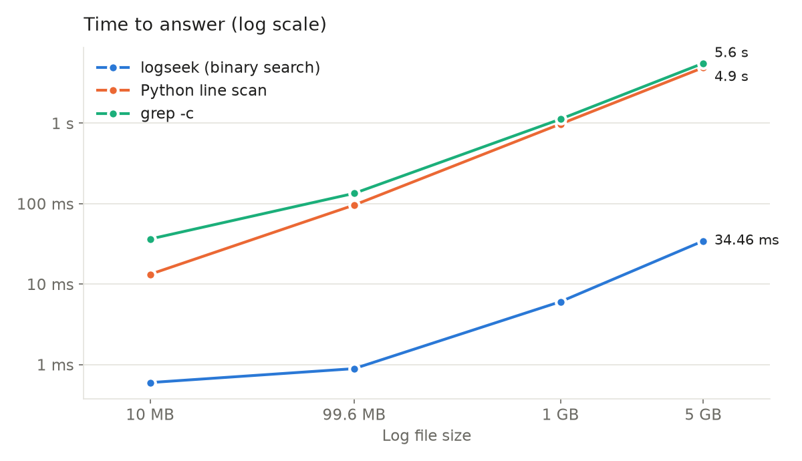
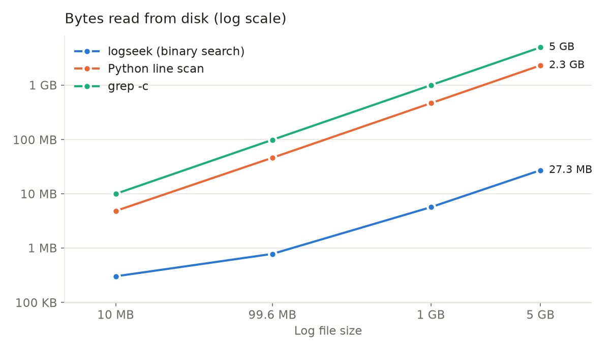

# Benchmarks

**Question asked of every method:** *how many ERROR lines were logged between 14:05 and 14:10?*

| File | logseek | Python scan | grep | Speed-up vs grep | logseek reads | jumps |
|---|---|---|---|---|---|---|
| 10 MB | 0.60 ms | 13.27 ms | 36.40 ms | 61x | 305.9 KB | 47 |
| 99.6 MB | 0.89 ms | 96.21 ms | 134.48 ms | 151x | 794 KB | 51 |
| 1 GB | 6.06 ms | 979.02 ms | 1.1 s | 186x | 5.7 MB | 59 |
| 5 GB | 34.46 ms | 4.9 s | 5.6 s | 162x | 27.3 MB | 65 |

All three methods return the same count for every file (the run fails if they don't).
Times are the median of 3 runs.





## The three methods

- **logseek:** two binary searches on byte offsets find where 14:05 and 14:10 start, then
  `bytes.count(b" ERROR ")` counts inside that window only.
- **Python scan:** the script most people write first. Read line by line from the top, skip
  lines before 14:05, count until 14:10, then stop (it uses the fact that the file is
  sorted, so it never reads past 14:10).
- **grep:** `grep -c -E "^2026-11-19 14:0[5-9]:.* ERROR " file`. Fast C code, but it reads
  the whole file every time, and the time range has to be written by hand as a regex.

## What the numbers say

- **Finding the window is almost free.** 47 jumps at 10 MB, 65 jumps at 5 GB: ~2 more jumps
  each time the file doubles (`log2`). That part takes well under 1 ms at every size.
- **logseek's time grows only because the answer grows.** The generator spreads a day of logs
  over the whole file, so 5 minutes of a 5 GB file is ~27 MB. logseek reads that window and
  nothing else: the 27 MB *is* the answer.
- **The scan and grep read everything before the answer** (2.3 GB and 5 GB at the 5 GB size).
  Their time grows in a straight line with the file: 10x the file, 10x the wait.
- **grep is not the bottleneck's fix.** It is C, but it cannot skip: at 1 GB and above it is
  as slow as the Python scan, because both are limited by reading the bytes.

## Run it yourself

```bash
pip install -e ".[bench]"
python -m logseek.bench --sizes 10MB,100MB,1GB,5GB    # generates data/bench/*.log once
```

It writes `bench/results.json`, `bench/bench_time.png` and `bench/bench_bytes.png`.

Machine: Windows 11, Intel Core (12th gen), SSD, Python 3.13.5, GNU grep 3.0 (Git for
Windows). The files were in the OS cache (warm), which is the fair case for grep; on a cold
disk the scan and grep get slower while logseek reads almost nothing.
